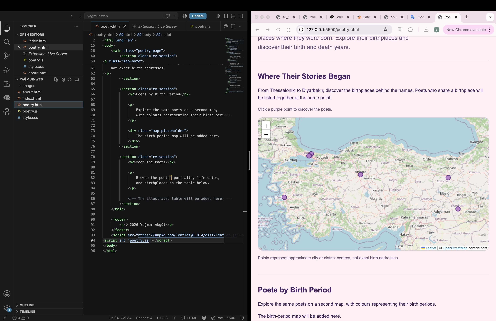
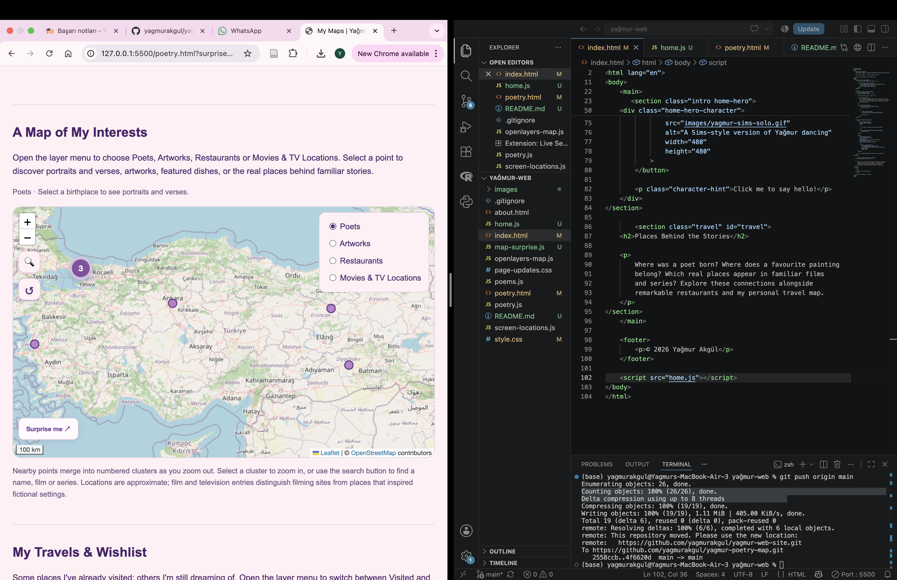

# Yağmur Akgül | Places & Stories

A personal website created for GMT458 — Web GIS at Hacettepe
University. It brings together my academic background and interests
in poetry, art, food, films and travel.

🌐 [Visit the website](https://yagmurakgul.github.io/yagmur-web-site/)

## Website Overview

- **Home:** A personal introduction, an animated Sims-style character
  with a clickable speech bubble, and a “Surprise me” link.
- **About:** My education, technical skills and internship experience.
- **My Maps:** Two interactive maps and expandable illustrated tables.

## Interactive Maps

### Culture Map — Leaflet

Four selectable categories:

- **Poets:** 11 Turkish poets, their birthplaces, portraits and verses.
- **Artworks:** 10 artworks and their museums or venues.
- **Restaurants:** 10 Michelin-starred restaurants and featured dishes.
- **Movies & TV Locations:** 9 filming locations or places that
  inspired fictional settings.

Features include image popups, search, marker clustering,
a reset control and random location discovery.

Markers appear only at or above the category’s zoom threshold.
Clustering groups nearby points when zooming out.

### Travel Map — OpenLayers

Two categories display destinations I have visited and those
on my wishlist. Selecting a destination opens a short note.

Visited destinations: France, Belgium, Germany and Luxembourg.

Wishlist: Spain, Scotland, Japan, Thailand, Taiwan, Italy,
New Zealand and Argentina.

Both maps include settings to prevent repeated world copies.

## Development Journey

At first, I was unsure what to create. I wanted a project that
felt personal and distinctive, rather than only mapping my travels.

I began with the birthplaces of poets whose work I enjoy.
I then added portraits and verses, followed by artworks,
restaurants and film locations as separate categories.

*The early poetry map during development.*

As the project grew, I added search, clustering, expandable
collections and a separate travel map. I later refined the
visual design and added the animated character.

*The expanded culture map before the final navy redesign.*

Testing on a phone revealed that popups closed immediately
after opening. I adjusted marker click handling and popup
behaviour to resolve this issue.

## Technologies

HTML, CSS, JavaScript, Leaflet, Leaflet.markercluster,
OpenLayers and OpenStreetMap.

Developed in Visual Studio Code, versioned with Git
and hosted on GitHub Pages.

## Run Locally

1. Download or clone the repository.
2. Open the folder in Visual Studio Code.
3. Open `index.html` using the Live Server extension.

An internet connection is required for map tiles,
fonts and externally hosted libraries. No build step is needed.

## AI Assistance

I used ChatGPT for brainstorming, coding guidance, troubleshooting
and documentation. Specific topics included layer switching,
zoom thresholds, marker clustering, image paths and mobile
popup interactions.

AI also helped generate the character artwork and adapt
the galaxy background.

**Estimated total AI usage:** [4 hours]

## Notes and Credits

Coordinates are approximate. Travel points represent destinations,
not exact locations visited. Film entries distinguish filming sites
from inspirations. Michelin ratings and menus may change.

Map data © OpenStreetMap contributors.
Images, artworks and quoted verses belong to their respective
creators and rights holders.

## Author

**Yağmur Akgül**  
Geomatics Engineering student — Hacettepe University